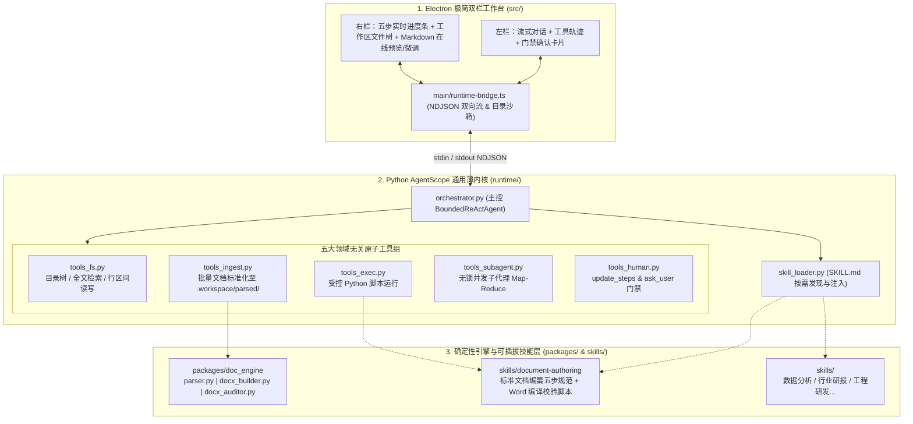

# 五步认知闭环与通用薄内核架构

无论是编写十万字工程技术方案、审计五十份财务报表，还是构建多模块软件系统，人类专家处理任何复杂任务的底层逻辑都高度一致。**Mayi Agent Plus** 将这一通用规律提炼为内核级的**五步认知闭环**，并将具体行业规范剥离为可插拔的 `skills/`。

---

## 一、系统三层全景架构图

---

## 二、五步底层认知闭环详解

| 阶段标识 | 认知阶段 | 核心动作与工作区标准产物 |
| :--- | :--- | :--- |
| `perceive` | **1. 环境感知与标准化** | `scan_directory` 秒扫文件清单 $\rightarrow$ `ingest_documents` 一次性将 PDF/Word/Excel 批量解析为 `.workspace/parsed/<doc>/full.md`（含页码锚点、表格与异常页提示），SHA-256 哈希命中免重算。 |
| `align` | **2. 目标与约束对齐** | 基于毫秒级 `search_text` / `read_lines`（大资料集自动派并发只读子代理分片扫描），提炼全部硬性要求、评分标准、关键参数，输出 `.workspace/01-requirements.md`（每条附 `[文件名 P页码]` 定位）。 |
| `plan` | **3. 全局规划与门禁** | 对照 `01-requirements.md` 生成结构化执行蓝图或章节大纲 `.workspace/02-plan.md`。**简单任务直接推进；复杂高成本任务自动触发 `ask_user` 门禁**，支持用户在右栏直接微调大纲后放行。 |
| `execute` | **4. 分治执行产出** | 调用 `run_subagents` 启动并发独立子代理，按物理文件路径隔离写入（如 `.workspace/drafts/01-overview.md`、`02-method.md`），或调用 `run_python` 精确核算数据与生成图表。 |
| `verify` | **5. 客观验证与交付** | 先跑确定性校验脚本检查缺章、空表、占位符残留与数值一致性；再拉起全新上下文的独立 Reviewer 子代理对照 `01-requirements.md` 逐项挑刺修正，最终编译输出标准 `.docx` 等交付物。 |

---

## 三、前后端极简 NDJSON 双向流协议

主进程 `runtime-bridge.ts` 与 `runtime/main.py` 之间仅通过标准输入输出（UTF-8 NDJSON）传递 7 种纯净事件，无任何行业专有数据结构：

### Python $\rightarrow$ Electron（Stdout 事件流）
- `{"type": "delta", "text": "..."}`：助手流式文本增量；
- `{"type": "tool", "execution": {...}}`：工具开始执行与完成回执（用于在对话流折叠展示）；
- `{"type": "steps", "steps": [...]}`：五步认知进度看板实时状态同步；
- `{"type": "workspace_changed", "path": "..."}`：通知右栏刷新工作区文件列表与实时预览；
- `{"type": "gate", "id": "...", "kind": "plan_approval" | "script_approval" | "question", ...}`：触发前端门禁确认卡片并挂起等待用户决策；
- `{"type": "result", "status": "completed" | "paused", "text": "...", "deliverables": [...]}`：本轮回合最终收束结果；
- `{"type": "error", "message": "..."}`：运行异常上报。

### Electron $\rightarrow$ Python（Stdin 响应流）
- 首行：完整 JSON 会话请求（工作区目录、只读源目录、提示词、历史消息、模型配置）；
- 后续行：`{"type": "gate_response", "id": "...", "approved": true, "feedback": "..."}`（携带用户的放行确认或修改意见）。

---

## 四、如何新增一个通用领域 Skill？（标准 3 步 SOP）

无需修改任何 TypeScript 前端代码或 `runtime/` 内核代码：

1. 在 `skills/<skill-id>/` 下创建 `SKILL.md`，包含 YAML Frontmatter（`name`、`description`）及面向五步闭环的领域作业指南；
2. 若该领域涉及确定性文件生成或硬指标校验（如生成 PPT、跑财务勾稽关系检查），在 `skills/<skill-id>/scripts/` 下放置纯 Python CLI 脚本；
3. 重启或新建会话，`skill_loader.py` 会自动将技能摘要注册进主控视野，当用户任务匹配时由主控按需调用 `load_skill("<skill-id>")` 激活完整工作流。
