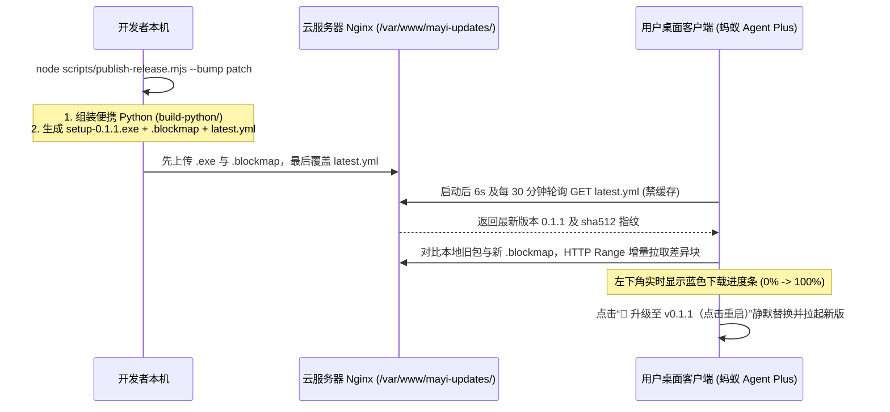

# 服务端部署与客户端自动热更新指南

本工程采用 **“客户端开箱即用离线一体包 + 自有云服务器 Nginx 差分热更新”** 生产架构：
- **零环境依赖**：打包脚本自动将独立可重定位 Python 3.12、AgentScope 薄内核、RapidOCR 及全套技能内置进安装包，终端用户电脑**无需安装 Python**。
- **零服务器算力成本**：几百 MB 的招标 PDF/Excel 解析与 Word 真实排版测页均在用户本机完成，商业标书不外传；云服务器仅需一个几 MB 内存的 Nginx 静态目录托管更新包。
- **`blockmap` 极速差分升级**：当你修改前端界面、升级青天质检规则或更新 Python 脚本并发出新版本后，已安装的客户端会自动对比 `.blockmap` 块哈希，**通过 HTTP Range 请求在后台仅下载变动的几 MB 数据块**，下载完毕后在左下角提示一键重启生效（或关闭软件时静默完成覆盖升级）。

---

## 一、全链路自动更新原理



---

## 二、第 1 步：在你的 Linux 云服务器配置 Nginx（仅首次做一次）

1. 登录你的云服务器，创建用于存放安装包与热更索引的静态目录：
   ```bash
   sudo mkdir -p /var/www/mayi-updates
   sudo chown -R root:root /var/www/mayi-updates
   sudo chmod -R 755 /var/www/mayi-updates
   ```
2. 将项目中的 [deploy/nginx-mayi-updates.conf](file:///D:/project-test/mayi-agent-plus/deploy/nginx-mayi-updates.conf) 合入你的 Nginx 站点配置（若使用**宝塔面板**，直接在对应网站的“配置文件”中添加其中的 `location /mayi-updates/ { ... }` 代码块即可）。
   > [!IMPORTANT]
   > 务必保留模板中对 `\.yml$` 的 `Cache-Control: no-store, no-cache` 配置！如果 `latest.yml` 被 Nginx 或 CDN 缓存，客户端将无法及时感知你刚发布的新版本。
3. 重载 Nginx 配置使其生效：
   ```bash
   sudo nginx -t && sudo nginx -s reload
   ```
   此时你的热更新源地址即为：`https://你的域名或公网IP/mayi-updates/`。

---

## 三、第 2 步：首次打包并上传首发版（如 `v0.1.0`）

在你本地开发机 `D:\project-test\mayi-agent-plus` 目录下执行一键发布脚本（首次指定你的服务器地址）：

```powershell
node scripts/publish-release.mjs --version 0.1.0 --url https://你的域名或IP/mayi-updates/
```

命令执行完成后，`release/` 目录会生成 4 个核心文件：
1. `mayi-agent-plus-setup-0.1.0.exe`：发给用户的首发安装包（纯英文文件名，彻底规避 Linux Nginx 中文空格 URL 404 问题，安装后桌面快捷方式仍为中文 **“蚂蚁 Agent Plus”**）；
2. `mayi-agent-plus-setup-0.1.0.exe.blockmap`：块级哈希映射表（供后续差分热更比对）；
3. `latest.yml`：当前最新版本号、文件名与 SHA-512 校验清单；
4. `index.html`：自动生成的网页下载中心页面（同事在浏览器打开 `https://你的域名或IP/mayi-updates/` 即可直接点击按钮下载安装包）。

如果你本机已配置服务器 SSH 免密登录，可直接追加 `--scp` 一键上传：
```powershell
node scripts/publish-release.mjs --version 0.1.0 --url https://你的域名或IP/mayi-updates/ --scp root@你的服务器IP:/var/www/mayi-updates
```
（若用宝塔面板或 Xftp 手动上传，只需把上述 4 个文件拖入 `/var/www/mayi-updates/` 即可。）

---

## 四、第 3 步：后续日常更新发版（客户端自动监听下载）

后续无论你修改了 Vue 界面、`runtime/` 代码还是升级了 `skills/document-authoring` 青天质检规则，只需执行**一行命令**即可完成版本号自增、增量打包与原子发布：

```powershell
# 自动将版本号从 0.1.0 升为 0.1.1，打包并按原子顺序（先传 .exe/.blockmap，最后覆盖 latest.yml）发布到服务器
node scripts/publish-release.mjs --bump patch --scp root@你的服务器IP:/var/www/mayi-updates
```

### 客户端侧的用户体验
1. **自动监听**：用户打开软件 6 秒后自动检查一次，运行期间每 **30 分钟**在后台静默检查一次（也可在左下角 **“⚙️ 设置”** 中点击“检查更新”，或动态修改测试服务器 URL）。
2. **无感后台差分下载**：监听到服务器 `latest.yml` 版本号高于本机版本时，无需弹窗打扰，直接在左下角显示蓝色进度条后台增量拉取差异块（若仅改了业务代码/Skill，通常只需下载几 MB）。
3. **任务保护与静默安装**：下载达 100% 后，左下角变为绿色按钮 **“🚀 升级至 v0.1.1（点击重启）”**：
   - 若当前有标书任务正在运行，点击时会先弹窗保护确认，避免误断任务；
   - 即使用户不点重启按钮，当用户正常关闭软件退出时（`autoInstallOnAppQuit = true`），也会自动静默完成升级，下次打开即为新版本。
