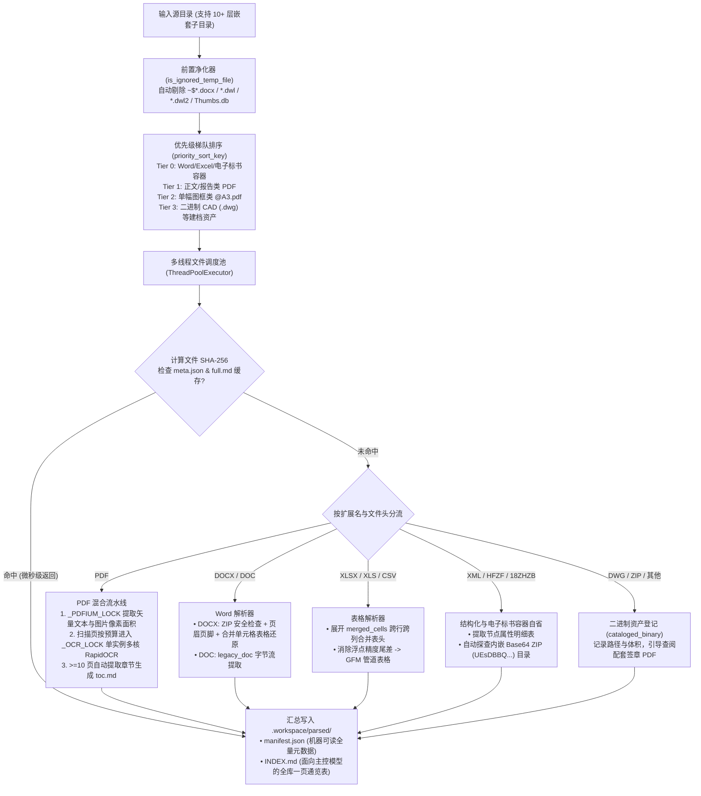

# `doc_engine` 离线文档标准化与原生 Word 编译引擎实现方案

`packages/doc_engine` 是 **Mayi Agent Plus** 感知层与交付层的核心确定性底座。它的存在只有一个核心使命：**把一切缓慢、脆弱、易出错的二进制办公文档解析与复杂排版工作，彻底从大模型的在线 ReAct 循环中剥离出来**。

---

## 一、架构定位与模块职责边界

`doc_engine` 严格遵循**“零 Agent 状态耦合、纯函数/文件输入输出、可独立 CLI 运行”**原则，内部不包含任何大模型调用或会话记忆逻辑：

```text
packages/doc_engine/
├── __init__.py       # 统一导出解析、编译与审计核心 API
├── parser.py         # [正向感知] 多格式文档 -> 带页码锚点 Markdown + 章节 TOC + 全局 INDEX 缓存
├── docx_builder.py   # [逆向交付] 受控标准 Markdown + 版式预设 JSON -> 原生高质量 Word (.docx)
└── docx_auditor.py   # [客观门禁] 草稿占位符/断链扫描 + 成品 .docx 结构与页数体检
```

---

## 二、`parser.py`：生产级离线多格式标准化方案

### 1. 整体处理流水线



### 2. 五项关键工程实现细节

#### （1）防同名覆盖的内容寻址目录命名（`_safe_cache_slug`）
在真实工程项目资料包中，不同子目录下极易出现完全同名的文件（例如 `3、工程量清单excel/.../道路工程.xls` 与 `4、最高投标限价excel/.../道路工程.xls`）。
- 若仅以文件名命名缓存目录会导致互相覆盖；若纯用 64 位哈希命名则人类排障难以阅读。
- **方案**：拼接**最后两级父目录名 + 文件主名 + 内容 `SHA-256` 前 10 位**（如 `3_工程量清单excel_1_道路工程_道路工程-a25e0bf560`），兼顾直观可读性与全局唯一性，且源文件哪怕修改一个字节也会自动触发缓存失效重算。

#### （2）PDF 矢量优先 + 扫描页分级预算 OCR + 按需补识
针对复杂资料包里同时存在“几百页原生文字标书”、“几十页纯扫描评估报告”与“上百张高像素扫描蓝图”的混合场景，引擎采用**两级协同策略**：
- **精准判定是否需要 OCR**：通过 `pypdfium2` 统计每页原生紧凑字符数 `compact_len` 与内嵌图像对象（`FPDF_PAGEOBJ_IMAGE`）总像素面积 `img_pixels`。凡是具备正常原生矢量文字层的页面（包括纯矢量导出的 CAD 图框），直接毫秒级提取原生文字，绝不空跑图像渲染。
- **首轮自动 OCR 预算控制（`_BatchOcrBudget`）**：单次整库摄入默认携带全局自动 OCR 页数预算（默认 15 页，单文档上限 6 页），按 `priority_sort_key` 优先将核心报告封面、资质页、目录与摘要自动识别落盘；超出预算的其余扫描页不阻塞整库建档，在 `full.md` 对应页码锚点下写入明确提示，开放原子工具 `ocr_pdf_pages(source_path, start_page, end_page)` 供主控或调研子代理按需精准补识并永久写回缓存。
- **OCR 行带聚类重排（`_ocr_pil_image`）**：针对扫描表格与多栏文本，根据文本框纵向坐标 `top` 与行高聚类为水平行带，同带内按横向坐标 `left` 从左到右拼接，避免扫描件左右分栏文字上下错乱。

#### （3）长文档自动生成 `toc.md` 章节页码地图
对于页数 $\ge 10$ 页的 PDF（如 227 页的《招标文件正文.pdf》），解析器自动扫描每页前部符合 `第X章`、`X.X` 等特征的正文标题行（自动过滤带 `……` 省略号的原目录页），生成独立的 `toc.md`：

```markdown
# 文档章节页码导航：招标文件正文.pdf（共 227 页）
- [P5] 第一章 招标公告
- [P5] 2.7 合同估算价：1771.818 万元
- [P5] 2.8 计划工期：240 日历天
- [P10] 第二章 投标人须知
```

主控模型只需读取几十行的 `toc.md`，即可在 1 次工具调用内锁定关键条款所在的物理页码区间。

#### （4）Excel / Word 合并单元格展开与数值清洗
- **合并表头对齐**：工程量清单与控制价表普遍包含多级跨列合并表头。`parser.py` 在 `.xlsx`（`ws.merged_cells.ranges`）与 `.xls`（`sheet.merged_cells`）及 `.docx`（`w:gridSpan` / `w:vMerge`）解析时，自动将左上角主格文本展开填充至合并区间子格，确保生成的 Markdown 管道表格每一列语义自洽、列数严格对齐。
- **浮点噪声消除**：通过 `format(value, ".12g")` 自动将 Excel 底层二进制浮点误差（如 `3.5700000000000003`）还原为干净的 `3.57`。
- **超大表脚本联动**：单个 Sheet 超过 600 行时，Markdown 仅保留前 600 行结构预览并在表头显式提示原表绝对路径，引导模型调用 `run_python` 使用 `openpyxl` 做全表精确求和或筛选。

#### （5）通用 XML 与电子标书容器自省（`.xml` / `.18zhzb` / `.hfzf`）
各地公共资源交易系统的电子招标文件（如合肥 `.HFZF`、安徽计价 `.18zhzb`）本质上常是带自定义后缀的 UTF-8 XML 容器：
- 解析器通过后缀或 `<?xml` 魔数自动识别，提取根节点关键属性与前 350 条结构化业务节点生成明细表；
- 若检测到节点文本是以 `UEsDBBQ` 开头的长串（即 `PK\x03\x04` 的 Base64 编码内嵌 ZIP 压缩包），自动在内存中解码并列出内部归档文件目录清单，无需安装专有造价/招投标客户端即可看清内部结构。

### 3. 标准化缓存区目录契约

```text
.workspace/parsed/
├── INDEX.md                                  # 面向人类与主控模型的全库一页通览总表
├── manifest.json                             # 机器可读全量状态、哈希、页数与告警字典
├── 招标文件正文-615683d006/
│   ├── full.md                               # 含 <!-- page: 1 --> ... <!-- page: 227 --> 的完整正文
│   ├── toc.md                                # 自动提炼的章节与核心条款页码导航
│   ├── meta.json                             # SHA-256 指纹与解析版本戳
│   └── images/
│       └── page-0001.png                     # 触发了 OCR 的页面留存原图快照供复核
└── 评估报告_2-d6af74837f/
    ├── full.md
    ├── meta.json
    └── images/
```

---

## 三、`docx_builder.py` & `docx_auditor.py`：受控 Markdown 编译与质量体检

### 1. 为什么采用“Markdown 创作 + AST 编译”替代“模型直写 JSON Blocks”？

在第一代方案中，要求大模型直接输出深度嵌套的 JSON Semantic Blocks（包含每个词的 `runs`、表格百分比 `widths`、块级 `id` 与 `expected_sha256`），不仅单章消耗翻倍的输出 Token，而且极易因括号/字段漏写触发反复重试。

`docx_builder.py` 改为让模型用最自然流畅的**受控标准 Markdown** 写作，再由确定性编译器通过 `markdown-it-py` 解析为 AST 语法树，一对一生成 `python-docx` 原生对象：

| Markdown 语法元素 | 编译生成的原生 Word 对象与排版细节 |
| :--- | :--- |
| 文档标题 / 副标题入参 | 自动生成独立居中封面页 + 原生自动目录域 `TOC \o "1-3" \h \z \u` + 页眉与居中 `PAGE` 页码页脚 |
| `#` ~ `####` 标题 | 映射为原生 `Heading 1` ~ `Heading 4`，强制开启 `keep_with_next=True` 防止标题孤行留在页底 |
| 普通正文段落 | 两端对齐（`JUSTIFY`），自动施加中文首行缩进 2 字符（`body_size_pt * 2`），中西文字体双轨绑定（`w:eastAsia` 宋体/黑体 + 西文 Times New Roman） |
| `表 X-X ...` 题注行 | 正则识别紧邻表格上方的题注，自动居中加粗、取消首行缩进并开启 `keep_with_next=True` 与下表同页 |
| GFM 管道表格 | 原生单线全边框表格，按各列文本长度智能分配列宽权重，首行填充底纹居中加粗并注入 `<w:tblHeader/>` 实现**跨页自动重复表头** |
| `` | 校验路径位于工作区沙箱内后，按页面可用版心宽度自适应居中插入原图，并在下方自动生成规范图题 |

### 2. 双阶段客观质量门禁（`docx_auditor.py`）

- **编译前草稿硬检（`audit_markdown_drafts`）**：逐行扫描全部章节草稿，硬性拦截 `TODO / TBD / FIXME`、`待补充 / 此处略 / 内容略`、连续 `XXX` 等未完成占位词，检查单章最低有效字数、一级标题规范性与插图路径断链。
- **编译后成品复检（`audit_docx_file`）**：重新用 `python-docx` 打开生成的 `.docx` 二进制文件，验证 `Heading 1` 章节数、检查是否存在空表格或占位符漏网，并按中文字数与表格数量给出预估页数。
- **真实排版测页（`measure_real_page_count`，M5 新增）**：传入 `max_pages` 时，通过 PowerShell 驱动本机 Word COM 只读打开成品并 `ComputeStatistics` 取真实页数（无 Word 时降级 LibreOffice 转 PDF 计页，均不可用时退回估算并显式告警）。超限即判 `passed: false`。字符估算仅作参考——M5 实测其偏差可达 ±20%，不能作为页数红线依据。

---

## 四、真实复杂工程资料压测复盘与四大踩坑实录

在针对真实市政道路招投标全套资料（`6.10（山水）延锋地块`，共 **248 个文件、最深 10 层子目录、629 页 PDF**）进行全量压测时，我们定位并根治了四个极具代表性的工程问题：

### 踩坑 1：Windows 下多线程并发调用 `RapidOCR (onnxruntime)` 引发底层死锁
- **现象**：外层 `ThreadPoolExecutor(max_workers=4)` 同时解析多份扫描 PDF 时，进度推进到第 40 个文件后 CPU 跌至 0%，进程永久挂起。
- **根因**：Windows 平台下 `onnxruntime` 默认的 OpenMP 内部线程池在被多个 Python 线程并发调用 `InferenceSession.run()` 时会发生锁竞争死锁；同时在工作线程内部嵌套拉起 `ProcessPoolExecutor` 还会触发 Windows `spawn` 重导入警告与句柄阻塞。
- **解法**：全局维护**单实例多核 `RapidOCR`**（配置 `intra_op_num_threads=4~8`、`use_cls=False`、`rec_batch_num=8` 行批处理加速），外围加一把轻量 `_OCR_LOCK` 互斥锁串行进入推理；非扫描文档的 3 个工作线程完全不受阻塞，2 秒内即可扫完其余两百份原生文本文件。

### 踩坑 2：`pypdfium2` 底层 C 库非线程安全
- **现象**：多线程同时调用 `pdfium.PdfDocument` 读取不同 PDF 时偶发底层内存访问异常或卡顿。
- **解法**：引入独立的 `_PDFIUM_LOCK` 保护极快的 C 层文本提取与位图渲染（每页仅 1~15ms），将耗时的图像编码与 OCR 放在 `_PDFIUM_LOCK` 之外执行。

### 踩坑 3：`签章图纸/` 下 158 张 1700 万像素栅格化 A3 蓝图拖慢首轮建档
- **现象**：虽然主目录已有可编辑的《施工图设计说明.doc》和《图纸目录.xlsx》，但审图子目录下附带了 158 张整幅栅格化的 `@A3.pdf` 签章蓝图（`p1_chars=0, p1_img_px=16,921,189`）。若首轮无差别对全部 200+ 页大图做 CPU OCR，首次导入需耗时近 20 分钟。
- **解法**：采用**“优先级排序 + 批次自动 OCR 预算（15 页）+ `ocr_pdf_pages` 按需精准补识”**组合拳。实测全量 244 个有效文件首次建档仅需约 2 分钟（207 份文档 100% `ready`、37 份 `.dwg` 完整建档、`0` 失败），二次运行缓存全命中仅需 **`1.59 秒`**。

### 踩坑 4：地勘报告 `.docx` 钻孔照片误触发 OCR 与全文检索杂讯
- **优化 1**：3.1 MB 的《地勘文字报告.docx》正文已有 2.4 万字原生文本，但内部附带 28 张钻孔岩芯照片与公式小图标。现限定仅当 `.docx` 正文字数极少（`< 600` 字，即纯贴图型文档）且图片像素 $\ge 120,000$ 时才启动内嵌图 OCR，地勘报告解析耗时从数十秒降至 **0.2 秒**。
- **优化 2**：`search_text(scope="parsed")` 限定仅扫描正文 `full.md` 与总表 `INDEX.md`（跳过 `meta.json` 与 `toc.md`），跨 207 份文档全文检索耗时稳定在 **`1.3 秒`** 以内，条条命中真实业务正文与准确页码。

---

## 五、独立命令行调试与压测速查

无需启动桌面端界面，你随时可在终端单独调用 `doc_engine.parser` 压测任意本地复杂文件夹：

```powershell
# 对任意复杂资料目录执行全量离线标准化压测
.\.venv\Scripts\python.exe -m packages.doc_engine.parser `
  --source "D:\Desktop\shizu\6.10（山水）延锋地块" `
  --workspace "D:\project-test\mayi-agent-plus\test-temp\audit-run" `
  --workers 4

# 若仅需极速提取原生文本层（跳过全部图像 OCR，百份文档约 3 秒完成）
.\.venv\Scripts\python.exe -m packages.doc_engine.parser `
  --source "D:\Desktop\shizu\6.10（山水）延锋地块" `
  --workspace "D:\project-test\mayi-agent-plus\test-temp\fast-run" `
  --no-ocr
```
