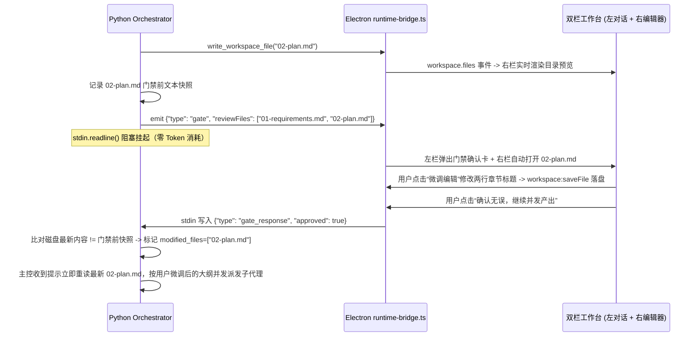

# AgentScope 薄内核与双栏工作台实现详解

本文介绍 `runtime/`（Python 通用智能体薄内核）与 `src/`（Electron + Vue 3 双栏工作台）之间的协同机制、大规模资料三级导航、长周期稳定性保护机制以及里程碑演进路线。

---

## 一、五大领域无关原子工具集契约（共 13 个正交工具）

为了确保内核能通吃“长文档编纂、数据分析、代码研发、专题调研”等任意复杂任务，`runtime/` 不定义任何行业私有参数，仅向 `BoundedReActAgent` 暴露 5 组正交原子工具：

| 工具分组 | 模块文件 | 工具函数 | 核心职责与安全边界 |
| :--- | :--- | :--- | :--- |
| **1. 文件、检索与页码直读** | `runtime/tools_fs.py` | `scan_directory` `search_text` `read_lines` `read_parsed_pages` `write_workspace_file` `edit_workspace_file` | • 外部 `source_dir` **严格只读**，支持 12 层深目录扫描并自动过滤 `~$` / `.dwl` 锁文件； • `search_text` 自动回溯最近的 `<!-- page: N -->` 锚点返回页码与行号； • **`read_parsed_pages`** 支持直接传源文件名（如 `'招标文件正文.pdf'`）与物理页码区间毫秒级翻页，免去手工查行号。 |
| **2. 文档标准化** | `runtime/tools_ingest.py` | `ingest_documents` `ocr_pdf_pages` | • 调用 `doc_engine.parser` 批量将复杂办公文件转为 `.workspace/parsed/` 缓存并生成全局 `INDEX.md`； • 对超长扫描件支持指定页码区间按需增量 OCR 并永久回写缓存。 |
| **3. 受控执行** | `runtime/tools_exec.py` | `run_python` | • 自动剥离环境变量中的 API 密钥（防泄露），注入 `MAYI_WORKSPACE_DIR` 与 `MAYI_SOURCE_DIR`； • 支持运行 `skills/<id>/scripts/*.py` 受信任脚本或模型自编的数据计算/制图脚本。 |
| **4. 并发分治** | `runtime/tools_subagent.py` | `run_subagents` | • 启动独立 `InMemoryMemory` 的并发子代理（支持 `researcher` / `author` / `reviewer` 三种角色）； • 自动注入工作区冻结底座摘要，通过 `allowed_write_file` 强制**一人一文件物理隔离**，完整原始报告无损归档至 `.workspace/subagents/`。 |
| **5. 人机协同与技能** | `runtime/tools_human.py` `runtime/skill_loader.py` | `update_cognitive_steps` `ask_user_gate` `load_skill_detail` | • 实时驱动右栏五步看板； • 门禁挂起等待期间自动比对 `review_files` 磁盘快照，精准感知用户在右栏的手工微调修改； • 按需动态加载并跨轮次保持 `skills/*/SKILL.md` 规程。 |

---

## 二、M3 薄内核五大生产级韧性机制（`runtime/session_state.py` & `orchestrator.py`）

面对 200+ 份复杂资料与 30~50 轮长周期推理，薄内核在不引入任何行业锁的前提下内置了五道通用工程护栏：

### 1. 大资料库“三级高速导航法”
针对上百份解析文档（如延锋地块 207 份文档 / 629 页 PDF）：
1. **一级看全貌**：先读 `.workspace/parsed/INDEX.md` 掌握核心文档列表、页数规模及哪些长文档附带 `toc.md`；
2. **二级定页码**：读长文档的 `toc.md`（章节页码导航）或调用 `search_text(scope="parsed")` 秒级锁定页码；
3. **三级精翻页**：直接调用 `read_parsed_pages("招标文件正文.pdf", 41, 45)` 毫秒级提取目标物理页全文，省去中间查行号的冗余轮次。

### 2. 超大工具输出自动溢出保护（`spill_large_tool_output`）
当单次工具返回结果超过 `14,000` 字符时，内核绝不粗暴截断成残缺非法的 JSON 字符串，而是自动将完整原文无损写入 `.workspace/.tool_outputs/<tool>_<id>.json`，并向模型返回合法 JSON 信封（含 `10,000` 字前段预览 + `saved_output_file` 路径），彻底杜绝单次大查询撑爆主控上下文。

### 3. 确定性零损耗上下文窗口压缩（`compact_memory_if_needed`）
传统 Agent 框架调用大模型对历史记忆做结构化 JSON 摘要时，常因中转接口 Schema 校验失败导致长任务中途崩溃，且白白消耗额外推理延迟。
由于 **Mayi Agent Plus** 的阶段成果全部实时落盘在工作区文件中，内核在 `pre_reasoning` 钩子中采用**确定性折叠策略**：当累计记忆超过 `56,000` 字符时，保留最近 10 条消息 100% 原文不动，仅将更早轮次中体积庞大的 `tool_result` 折叠为精简回执，并**严格维持 `tool_use` 与 `tool_result` 的 ID 配对合法性**——零模型调用开销、零摘要幻觉、零校验报错。

### 4. 跨轮次原子检查点与悬空工具自愈（`SessionStateManager` & `reconcile_interrupted_tools`）
- 每次工具动作完成后，通过 `checkpoint.tmp` 原子替换更新 `.workspace/.state/checkpoint.json`（保留上一版 `.backup.json`），同时持久化已激活的 `loaded_skills` 与五步进度。
- 若用户在工具运行中途点击“停止任务”或遇断网退出，下一轮发送“继续”恢复记忆时，`reconcile_interrupted_tools` 会自动检测所有未闭合的 `tool_use` ID 并补齐 `status="interrupted"` 系统回执，彻底根除 OpenAI/DeepSeek 接口 `tool_calls must be followed by tool messages` 的 400 报错。

### 5. 防死循环熔断器 + 子代理共享底座自动注入
- **防死循环熔断（`RepeatedFailureCircuitBreaker`）**：对 `(工具名 + 规范化参数哈希)` 计数，若模型连续 3 次以完全相同的参数调用失败，第 4 次立即短路拦截并要求模型更换方法或向用户说明缺失条件。
- **子代理底座自动注入（`_build_shared_briefing`）**：启动 `author` / `reviewer` 子代理时，宿主自动在系统提示词中附带工作区最新的 `01-requirements.md` 与 `02-plan.md` 摘要；启动 `researcher` 子代理时自动附带已解析资料清单速览——每个子代理省去前 3~4 轮盲目探路调用，且天然对齐全局核心参数口径。

---

## 三、自适应门禁与“右栏在线微调”闭环时序

---

## 四、分阶段演进路线图与当前进度

| 里程碑 | 核心目标 | 当前状态 |
| :--- | :--- | :--- |
| **M1：纯净工程骨架与双栏底座** | 独立工程初始化、零行业耦合协议、Electron 双栏工作台、NDJSON 流式通信、Docsify 文档站 | ✅ **已完成验收** |
| **M2：生产级离线文档标准化引擎** | 多格式解析、合并单元格还原、电子标书容器自省、分级预算 OCR + 按需补识、长文档 `toc.md` 与 `延锋地块` 248 文件零失败实测 | ✅ **已完成验收** |
| **M3：AgentScope 薄内核深度加固** | 三级页码直读导航、大输出无损溢出保护、零损耗确定性上下文瘦身、跨轮次检查点与中断工具自愈、防死循环熔断与子代理底座注入 | ✅ **已完成验收** |
| **M4：标杆技能与原生 Word 深化** | 复杂宽表自适应横竖版分节、甘特图/架构图/工艺图确定性绘制、技术暗标防废标全链路与跨章一致性体检 | ✅ **已完成验收** |
| **M5：复杂真实资料端到端成稿验收** | 以 `延锋地块` 真实复杂项目资料跑通从感知、提标、门禁微调、并发写稿到输出完整标准 `.docx` 全流程（实测 50 页 ≤ 50，详见 [M5 实战复盘](../skills/02-m5-yanfeng-case-study.md)） | ✅ **已完成验收** |
