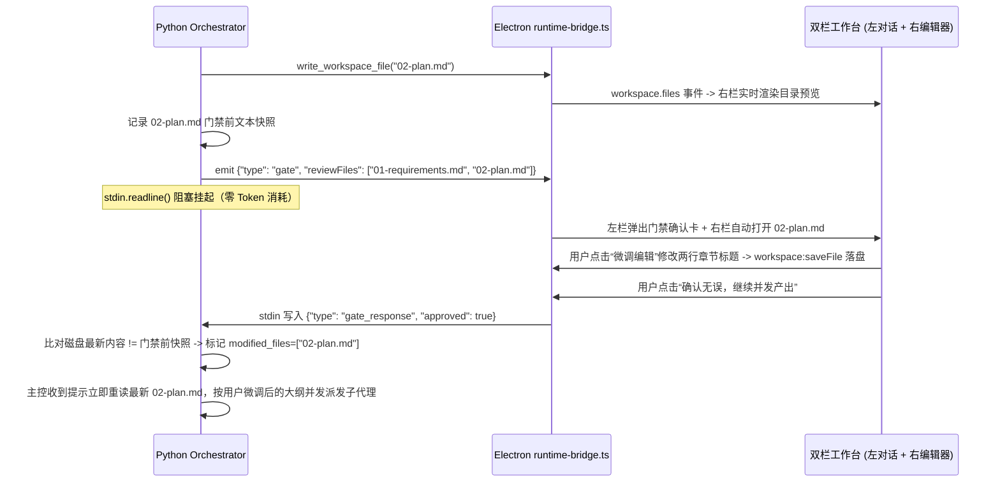

# AgentScope 薄内核与双栏工作台实现详解

本文介绍 `runtime/`（Python 通用智能体薄内核）与 `src/`（Electron + Vue 3 双栏工作台）之间的协同机制、安全沙箱边界以及里程碑演进路线。

---

## 一、五大领域无关原子工具集契约

为了确保内核能通吃“长文档编纂、数据分析、代码研发、专题调研”等任意复杂任务，`runtime/` 不定义任何行业私有参数，仅向 `BoundedReActAgent` 暴露 5 组共 12 个正交工具：

| 工具分组 | 模块文件 | 工具函数 | 核心职责与安全边界 |
| :--- | :--- | :--- | :--- |
| **1. 文件与检索** | `runtime/tools_fs.py` | `scan_directory` `search_text` `read_lines` `write_workspace_file` `edit_workspace_file` | • 外部 `source_dir` **严格只读**，默认支持 12 层深嵌套扫描并自动过滤 `~$` 锁文件； • `search_text` 自动回溯最近的 `<!-- page: N -->` 锚点，直接返回源文件页码与行号； • 所有写入严格限制在会话私有 `workspace_dir` 内。 |
| **2. 文档标准化** | `runtime/tools_ingest.py` | `ingest_documents` `ocr_pdf_pages` | • 调用 `doc_engine.parser` 批量将复杂办公文件转为 `.workspace/parsed/` 缓存并生成 `INDEX.md`； • 对超长扫描件支持指定页码区间按需增量 OCR 并回写缓存。 |
| **3. 受控执行** | `runtime/tools_exec.py` | `run_python` | • 自动剥离环境变量中的 API 密钥（防泄露），注入 `MAYI_WORKSPACE_DIR` 与 `MAYI_SOURCE_DIR`； • 支持运行 `skills/<id>/scripts/*.py` 受信任脚本或模型编写的精确计算/校验脚本。 |
| **4. 并发分治** | `runtime/tools_subagent.py` | `run_subagents` | • 启动拥有独立干净 `InMemoryMemory` 的并发子代理（支持 `researcher` / `author` / `reviewer` 三种认知角色）； • 通过 `allowed_write_file` 强制**一人一文件物理隔离**，无需乐观锁即可安全并行撰稿。 |
| **5. 人机协同** | `runtime/tools_human.py` `runtime/skill_loader.py` | `update_cognitive_steps` `ask_user_gate` `load_skill_detail` | • 实时驱动右栏五步看板； • 门禁挂起等待期间自动快照 `review_files` 文本，精准感知用户在右栏的手工微调修改； • 按需动态加载 `skills/*/SKILL.md`。 |

---

## 二、自适应门禁与“右栏在线微调”闭环时序

复杂任务最怕“方向偏了一点，闷头跑二十分钟全白干”。双栏工作台通过文件快照比对实现了极轻量的**人机共创闭环**：

---

## 三、分阶段演进路线图与当前进度

| 里程碑 | 核心目标 | 当前状态 |
| :--- | :--- | :--- |
| **M1：纯净工程骨架与双栏底座** | 独立工程初始化、零行业耦合协议、Electron 双栏工作台、NDJSON 流式通信、Docsify 文档站 | ✅ **已完成验收** |
| **M2：生产级离线文档标准化引擎** | 多格式解析、合并单元格还原、电子标书容器自省、分级预算 OCR + 按需补识、长文档 `toc.md` 与 `延锋地块` 248 文件零失败实测 | ✅ **已完成验收** |
| **M3：AgentScope 薄内核深度加固** | 超大工具返回结果自动分片落盘保护、跨轮次会话记忆持久化与中断续跑、200+ 文档场景下的智能索引导航调优 | ⏳ **下一阶段推进** |
| **M4：标杆技能与原生 Word 深化** | 复杂宽表自适应横竖版分节、工程图表绘制嵌入、多轮独立 Reviewer 闭环打磨 | 📋 **待深化** |
| **M5：复杂真实资料端到端成稿验收** | 以 `延锋地块` 等真实复杂项目资料跑通从感知、提标、门禁微调、并发写稿到输出完整标准 `.docx` 全流程 | 📋 **待验收** |
