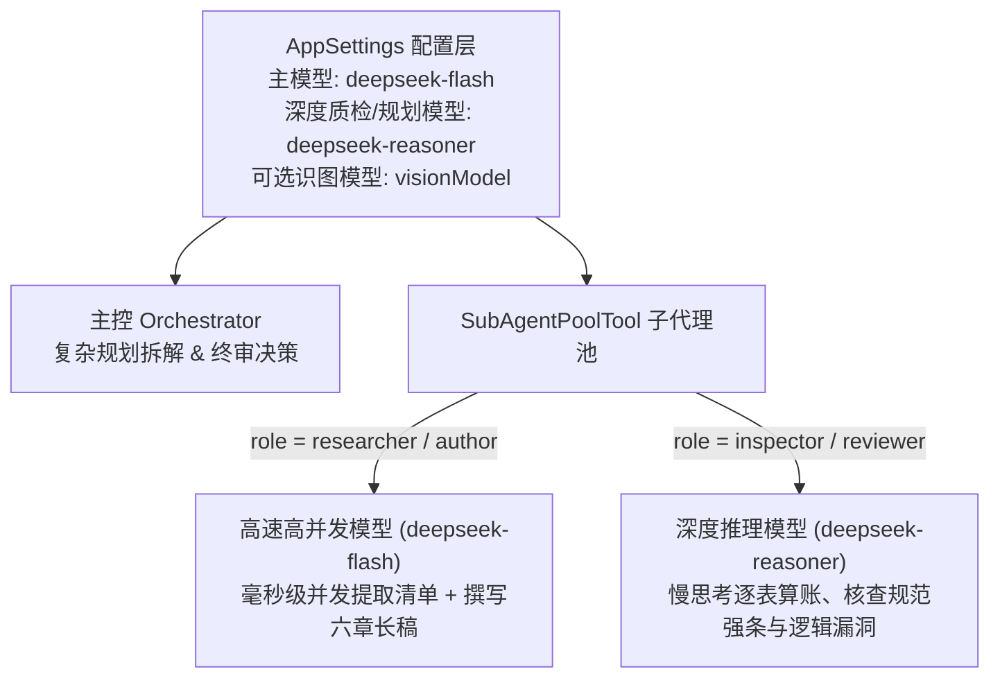
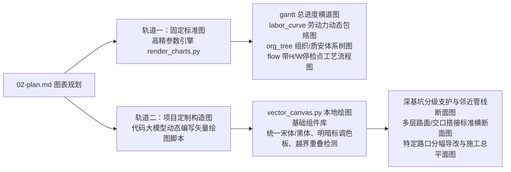

# 蚂蚁 Agent Plus 演进路线图与待办设计方案（Roadmap & TODO）

> **战略优先级原则**：优先聚焦 **“施组文档高标准化、高评标得分与防废标/防雷同核心护城河（P0）”**，将拉低技术标专业感或存在评标失分风险的短板彻底打透；界面美化、包体瘦身与商业分发网关归入次优先级（P1/P2）按需推进。

---

## 一、全局待办优先级总览

| 优先级 | 编号 | 待办模块 | 核心目标与评标提分价值 | 状态 |
|---|---|---|---|---|
| **P0（最高）** | **P0-1** | **本地历史标书指纹库与青天防雷同查重雷达** | 对标合肥青天大模型“雷达监测”，拦截同一企业跨项目 AI 施组句式撞车，杜绝雷同预警与废标风险 | 📋 待实施 |
| **P0（最高）** | **P0-2** | **多模型分工路由（`reasoner` 严审 + `flash` 快写 + `Qwen2.5-VL` 识图）** | 文本端同账号高低搭配降本提质，识图端独立接入多模态视觉大模型专攻扫描件与施工蓝图 | 📋 待实施 |
| **P0（最高）** | **P0-3** | **多模态视觉大模型（VLM）主力识图：专攻扫描件与 CAD 施工蓝图** | 原生电子文档走本地秒读，盖章扫描件与 `@A3.pdf` 施工蓝图由 `Qwen2.5-VL` 看懂引线、横断面与构造尺寸 | 📋 待实施 |
| **P0（最高）** | **P0-4** | **纯本地矢量制图双轨制（高精参数引擎 + 代码模型动态写矢量绘图脚本）** | 禁用文生图模型防汉字乱码与暗标废标；标准图走参数引擎，定制断面/导改图由代码模型写矢量脚本精准渲染 | 📋 待实施 |
| **P1（中）** | P1-1 | 右栏 `.png` 原生预览与青天五维雷达得分可视化卡 | 在工作台右栏直观展示配图大图与青天五维得分条、整改销项记录 | ⏳ 低优储备 |
| **P1（中）** | P1-2 | 客户端专属品牌 `.ico` 图标与安装包无损瘦身 | 替换默认 Electron 图标，剔除闲置子依赖与多国语言包（327MB → ~250MB） | ⏳ 低优储备 |
| **P1（中）** | P1-3 | Word/WPS COM 测页防弹窗死锁保护 | 防止新电脑 Office/WPS 首次激活弹窗阻塞后台测页进程 | ⏳ 低优储备 |
| **P2（低）** | P2-1 | 服务端轻量激活码与 API Key 额度转发网关 | 面向多同事/外部客户分发时隐藏主 API Key 并按账号控制调用额度 | ⏳ 远期储备 |

---

## 二、P0 核心护城河详细技术实施方案

### P0-1：本地历史标书指纹库与“青天防雷同查重雷达”

#### 1. 解决的核心痛点
合肥市公管局《合公信〔2025〕82号》中，“青天大模型”除 AI 类人评分外，内置了**雷达监测（文本相似性查重）**。若投标企业连续使用大模型编制多个项目的施组，容易在质量体系、安全文明措施、通用施工工艺段落出现高频句式雷同，触发电子评标系统雷同示警。

#### 2. 落盘位置与模块划分
- 新增核心引擎：`packages/doc_engine/similarity_radar.py`
- 接入质检流水线：`packages/doc_engine/qingtian_auditor.py`、`skills/document-authoring/scripts/qingtian_inspect.py`、`compile_word.py`
- 本地历史指纹仓库路径：默认存于用户数据目录 `~/.mayi-agent-plus/bid-vault/index.json`（支持环境变量 `MAYI_BID_VAULT_DIR` 覆盖，跨会话永久保留）

#### 3. 算法与防误报设计（纯 Python 毫秒级实现，零额外依赖）
1. **法定公共术语白名单剥离（防误报）**：
   - 计算指纹前自动剔除依法必须一致的国家/地方规范全称（如 `《城镇道路工程施工与质量验收规范》CJJ 1-2008`）、招标文件固定条款名与纯数字表格行，确保不会因合法引用同一部国标而误报雷同。
2. **双粒度碰撞检测算法**：
   - **篇章级 5-gram Winnowing 指纹集**：对每章纯中文技术叙述提取 5 字滑窗哈希集，计算与历史标书库各项目的 Jaccard 重合度与覆盖率（Containment Score）；
   - **长句级精确碰撞定位**：切分长度 $\ge 28$ 字的技术措施长句，精准抓出与历史标书高度雷同的具体行号、历史项目名称与原文片段。
3. **同项目多轮重修自动豁免（`project_key` 隔离）**：
   - 从 `01-requirements.md` 提取招标项目编号（如 `2026BFJGZ50374`）或项目正式标题生成唯一 `project_key`；同一项目在迭代精修时只与**其他历史项目**比对，不与自身上一轮草稿误撞。
4. **硬门禁阈值与自动入库闭环**：
   - **阻断红线**：与任一历史项目全文技术叙述重合率 `> 25%`，或单章重合率 `> 35%`，或存在 `≥ 5` 处超 30 字雷同长句时，在 `qingtian_inspect.py --mode radar` 中直接抛出 `[青天查重防雷同红线]` 阻断项，附带具体行号打回 `author` 结合当前工程工况差异化改写；
   - **签发自动归档**：当 `compile_word.py` 终审编译通过（`passed: true`）后，自动将本项目的章节指纹更新归档至 `bid-vault`，越用护城河越厚。

---

### P0-2：同账号双模型高低混搭路由与 `deepseek-reasoner` 深度适配

#### 1. 路由分工架构
复用同一套 DeepSeek 账号凭证（同时预留独立视觉模型凭证槽位），按认知难度精准分配模型算力：

#### 2. 涉及改动文件与关键技术细节
1. **协议与前端配置层**（`src/shared/protocol.ts`、`src/main/store.ts`、`SettingsModal.vue`）：
   - `AppSettings` 新增可选字段：
     - `reasoningModel?: string`（默认推荐填 `deepseek-reasoner`，留空时自动回退使用 `model`）；
     - `visionModel?: string`、`visionBaseUrl?: string`、`visionApiKey?: string`（预留多模态识图接口，折叠在高级选项中）。
2. **`deepseek-reasoner` 多轮工具调用协议关键适配（已排查源码确认）**：
   - **底层坑点**：经核查当前 `.venv` 内 `agentscope==1.0.21` 的 `_openai_formatter.py`（第 350 行），默认 `OpenAIChatFormatter` 在序列化历史消息时会跳过 `type == "thinking"` 块；而 DeepSeek 官方 `deepseek-reasoner` 接口在多轮 Tool Call 期间**强制要求同一轮 `role: "assistant"` 消息原样回传 `reasoning_content` 字段**（否则报 HTTP 400 `Missing reasoning_content`）。
   - **精确解法**：
     1. 在 `runtime/model_factory.py` 的 `build_generation_kwargs()` 中识别含 `reasoner` 或 `-r1` 的模型名：**不注入** `extra_body={"thinking": {"type": "disabled"}}`，并赋予 `max_tokens=32768`；
     2. 在 `runtime/model_factory.py` 中实现轻量级子类 `ReasoningAwareOpenAIFormatter(OpenAIChatFormatter)`：当组装含 `tool_calls` 的 `assistant` 消息时，自动提取该消息中的 `ThinkingBlock` 写入 `msg_openai["reasoning_content"]`（若缺失则补空串 `""` 兜底），彻底保证 `deepseek-reasoner` 在 `inspector` 多步读稿审核中 100% 零报错运行。
3. **子代理池按角色自动切换模型**（`runtime/orchestrator.py` & `runtime/tools_subagent.py`）：
   - `SubAgentPoolTool` 接收 `fast_model_builder` 与 `reasoning_model_builder`，当 `role in ("inspector", "reviewer")` 时自动挂载深度推理模型，其余并发提取与写稿角色挂载高速模型。

---

### P0-3：识图端接入多模态视觉大模型（如 `Qwen2.5-VL`），专门攻克扫描件与 CAD 施工蓝图

#### 1. 解决的核心痛点
传统本地 OCR（RapidOCR）只能识别孤立文字块，看不懂施工蓝图中的引出线、剖面符号、尺寸链及上下层空间从属关系，遇到盖红章的扫描补疑文件或复杂扫描业绩表也容易串行漏字。同时，延锋地块这类项目有 600+ 页 PDF，其中 80% 原生电子文字页无需消耗视觉 Token。

#### 2. “电子直读 + VLM 视觉主力精读”混合架构（`packages/doc_engine/blueprint_reader.py` + `runtime/tools_ingest.py`）
1. **智能分层分流（省钱、极速、高精度兼得）**：
   - **原生电子版 PDF / Word / Excel（约占 80%）**：继续走本地 `doc_engine` 确定性直读（1 秒完成、0 成本、工程量数字 100% 零误差）；
   - **扫描文档页（盖章补疑、扫描合同表）+ `@A3.pdf` CAD 施工蓝图（标准横断面图、路面结构图、交口竖向及渠化图、管线综合图）**：直接路由给**多模态视觉大模型（如阿里云百炼 `qwen2.5-vl-72b-instruct` 等 OpenAI 兼容视觉接口）**深度识图；本地 RapidOCR 仅保留作为断网或未填写视觉模型 Key 时的离线兜底。
2. **新增内核工具 `inspect_blueprint_vlm(doc_path, page_number=1, focus_prompt=..., crop_region=None, save_asset_as=None)`**：
   - 使用 `pypdfium2` 将目标蓝图页或扫描页渲染为高分辨率清晰 PNG（自动控制长边像素在 `2048~2560px` 最佳视觉识别区间）；
   - 调用独立配置的 `visionModel`（支持与主文本 DeepSeek 不同的 `visionBaseUrl` + `visionApiKey`，如通义千问 DashScope `https://dashscope.aliyuncs.com/compatible-mode/v1`），以市政/房建总工结构化提示词直接提取：
     - **图签信息**：图名、图号（如 `路施-02`）、比例尺；
     - **空间构造关系**：机动车道/非机动车道/人行道自上而下各结构层厚度与材料配比、路拱横坡、边坡放坡率、沟槽支护与管基包角尺寸；
     - **扫描表格还原**：将盖章扫描页还原为标准 GFM 管道表格写入解析缓存；
   - **大样图裁剪复用**：支持按归一化坐标 `crop_region` 裁剪原图关键节点大样存入 `assets/` 供正文章节直接引用。

---

### P0-4：画图端纯本地精准矢量双轨制（不用生图大模型，采用“固定标准图高精参数引擎 + 定制构造图动态编写矢量绘图代码”）

#### 1. 核心架构红线
**坚决不调用文生图大模型（如 Midjourney / DALL·E / Flux 等像素生成模型）绘制施组工程图**——此类模型必现汉字笔画残缺、工程数字篡改幻觉，且底层彩色灰阶噪点在合肥“技术暗标”评审中会直接触发废标。
画图端全部采用 **“100% 本地系统字库自绘矢量渲染”**，并按图表性质实行**双轨制分工**：

#### 2. 轨道一：固定标准图走高精参数引擎（`render_charts.py` 扩展）
针对结构范式固定、强依赖数值比例精度的标准图表，只需喂入 JSON 数据即可一键出图（原生支持彩色明标与 `--blind` 纯黑白斜线填充暗标，且**画布内绝不写死“图 X-Y”序号**）：
- 保留并精进：`gantt`（关键线路横道图）、`org_tree`（四级组织/质安树图）、`flow`（带 `◆危大节点` / `★H/W停检点` 蛇形工艺流程图）；
- **新增 `labor_curve`（劳动力动态投入柱状-折线包络图）**：自动绘制各阶段多工种堆叠柱状图 + 峰值包络线 + 均值基准虚线与均衡系数 `K`，直接命中第 4 章资源均衡性得分点。

#### 3. 轨道二：项目定制构造图由代码大模型动态编写矢量绘图代码（`packages/doc_engine/vector_canvas.py`）
针对每个工程千差万别、固定模板画不出针对性的**工程构造断面图与现场平面导改图**（例如延锋地块是“拉森钢板桩 + 两道 φ219 钢管横撑 + 紧邻供热管与轨交电缆”，另一项目则是“二级放坡 + 土钉墙喷锚”）：
1. **提供受控本地矢量绘图底座 `vector_canvas.py`**：
   - 预置 300 DPI 超采样抗锯齿画布、Windows 原生黑体/宋体自动加载器；
   - 预置**明标/暗标一键切换调色板**（`--blind` 模式下底层强制锁死 `#FFFFFF` 纯白底与 `#000000` 纯黑线条/剖面斜线图案，从源头杜绝任何违规彩色像素）；
   - 预置工程制图原语：尺寸标注双箭头线（`draw_dim_line`）、自动换行防溢出文本框（`draw_callout_box`）、土层/混凝土/碎石剖面填充纹样（`draw_hatch_rect`）；
   - **内置图元几何防重叠自检器**：保存 PNG 前自动检测所有文字包围盒（Bounding Box）是否越出画布边界或相互重叠压字，一旦检测到压字越界直接报错返回重叠坐标，倒逼微调坐标重跑，确保最终输出的每一张定制工程图都排版清爽、字正腔圆。
2. **分专业高分施组骨架与有效规范速查库**（`skills/document-authoring/references/domain-checklists.md`）：
   - 沉淀市政道路排水、房建总包、装饰改造等专业的必配章节骨架、产能验算公式模板与现行有效国行地标清单（剔除废止旧标准）。

---

## 三、建议落地实施顺序（后续开启开发时执行）

当准备进入代码实施阶段时，建议按以下 4 个原子步骤推进，每步均可独立单测闭环：
1. **Step 1**：落地 **P0-2 多模型路由与 `ReasoningAwareOpenAIFormatter`**（打通文本同账号 `deepseek-reasoner` + `flash` 分工，并接好独立 `Qwen2.5-VL` 视觉模型配置槽位）；
2. **Step 2**：落地 **P0-3 `Qwen2.5-VL` 扫描件与 CAD 施工蓝图识图工具**（在延锋地块真实 `@A3.pdf` 横断面与路面结构蓝图上实测提取尺寸构造）；
3. **Step 3**：落地 **P0-4 本地矢量制图双轨制**（扩充 `render_charts.py` 的 `labor_curve` 参数引擎 + 实现 `vector_canvas.py` 定制矢量绘图底座与防压字几何自检）；
4. **Step 4**：落地 **P0-1 本地历史标书指纹库与青天防雷同查重雷达**（将延锋地块归档入库，闭环跨项目雷同拦截）。
