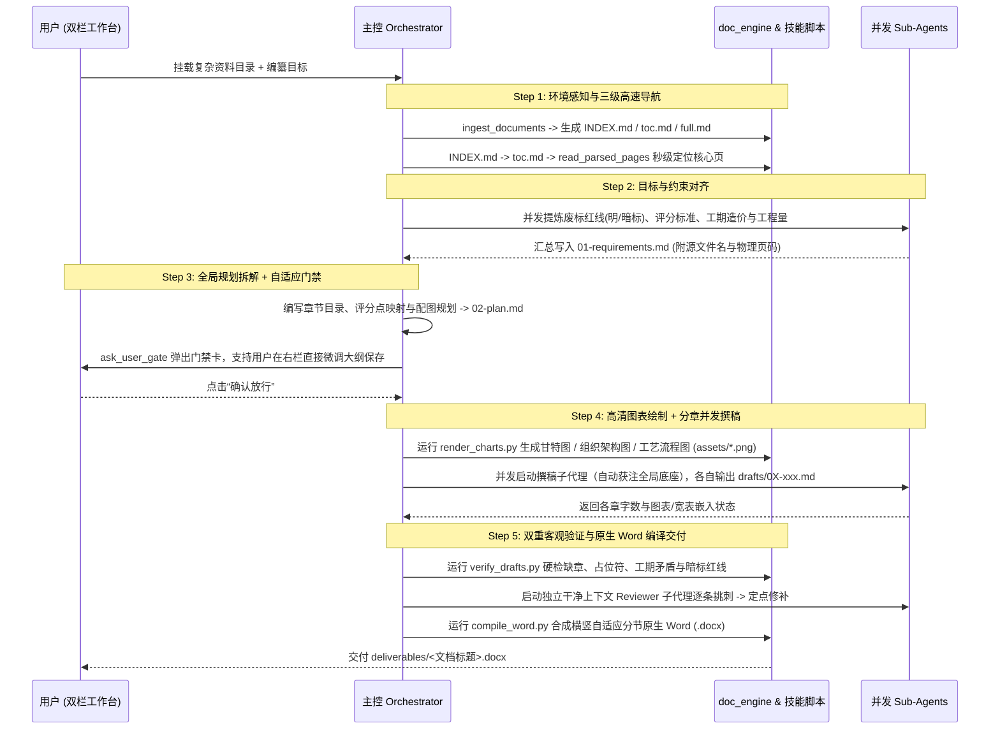

# 01 - 复杂标准长文档编纂 Skill (`document-authoring`)

`skills/document-authoring` 是验证 **Mayi Agent Plus** 五步认知闭环的首个标杆技能包，适用于工程施工组织设计（支持明标与严格技术暗标）、项目投标技术方案、可行性研究报告、行业深度调研报告等需要**严格响应上百份外部资料约束，并输出图文宽表兼备的出版级 `.docx`** 的复杂任务。

---

## 一、技能包目录组成

```text
skills/document-authoring/
├── SKILL.md                    # 核心作业规程（三级高速导航、图表生成、横竖分节、明暗标红线规范）
├── scripts/
│   ├── render_charts.py        # 基于 Pillow 原生绘制高分辨率甘特横道图、组织架构图、施工工艺流程图
│   ├── verify_drafts.py        # 多维确定性体检（02-plan 缺章对齐、占位符拦截、跨章总工期一致性、暗标署名/电话红线）
│   └── compile_word.py         # 将章节 Markdown + 图表 + 横竖版分节编译为原生 .docx 并执行成品复检
└── presets/
    ├── formal_bidding.json     # 正式投标明标/政务公文版式（宋体/黑体、22磅行距、自动封面与 TOC 目录）
    ├── blind_bidding.json      # 技术暗标安全合规版式（纯黑白零底纹、无封面署名、无页眉标识、严防废标）
    └── standard_report.json    # 现代商务/技术研报版式（微软雅黑、浅蓝表头底纹、左侧引用提示框）
```

---

## 二、端到端五步执行流水线



---

## 三、M4 出版级排版与图表核心能力

### 1. 三类高分辨率工程/商务配图确定性生成（`render_charts.py`）
无需依赖外网绘图接口或浏览器截图，直接通过 JSON 规格调用系统原生中文字体生成印刷级 PNG 配图（同时支持彩色明标与 `--blind` 纯黑白斜线阴影暗标主题）：
- **`gantt`（施工总进度横道图）**：自动计算时间刻度网格、持续天数列、关键线路高亮与工期跨度标注；
- **`org_tree`（组织管理/质安保证体系树图）**：决策层 $\rightarrow$ 副职层 $\rightarrow$ 职能部门 $\rightarrow$ 施工班组四级自动对称布局与正交连线；
- **`flow`（关键施工工艺与验收控制流程图）**：S 型多行蛇形流向卡片，内置 `★ 验收点` 质量关卡徽标。

### 2. 横竖版自适应分节与防劈行专业表格（`docx_builder.py`）
- **自动宽表横排**：当 Markdown 表格列数 $\ge 8$ 列（如多阶段设备配置表、工程量分解表）时，编译器自动新建横向 A4 分节（版心宽从 15.6cm 扩展至 24.3cm），表后自动切回竖向 A4；
- **显式横版指令**：在甘特横道图或大图前后书写 `<!-- page: landscape -->` 与 `<!-- page: portrait -->`，即可让大幅横道图满幅高清呈现；
- **原生细节保护**：所有表格默认注入 `<w:tblHeader/>`（跨页自动重复表头）与 `<w:cantSplit/>`（严禁单行在页底被劈成上下两半）。

### 3. 技术暗标“防废标”全链路闭环（`blind_bidding`）
针对公共资源交易技术暗标严苛的废标审查：
- **图表层**：`render_charts.py --blind` 输出纯白底、纯黑框线、斜线纹理区分非关键工序的无彩图表；
- **体检层**：`verify_drafts.py --blind` 自动拦截正文误写的公司署名、11 位手机号、电子邮箱及跨章工期超限；
- **编译层**：`compile_word.py --blind` 强制移除封面副标题与页眉文字，锁定全书 `#000000` 纯黑宋体/黑体，并在编译后由 `audit_docx_file(blind_mode=True)` 二次扫描所有 Run 色彩值与页眉段落。
