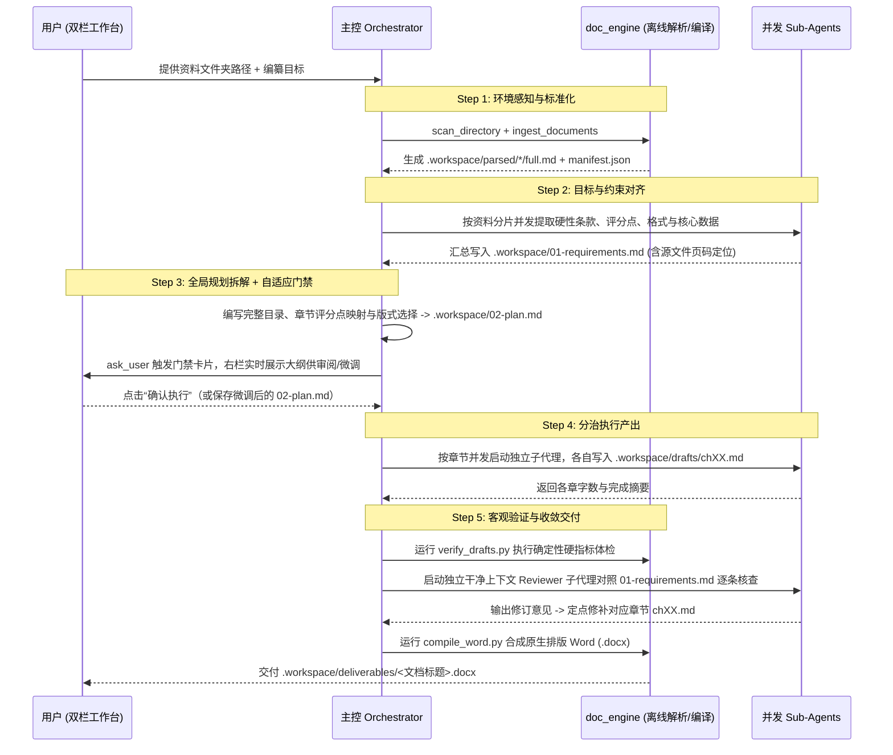

# 01 - 复杂标准长文档编纂 Skill (`document-authoring`)

`skills/document-authoring` 是验证 **Mayi Agent Plus** 五步认知闭环的首个标杆技能包，适用于工程施工组织设计、项目投标技术文件、可行性研究报告、行业深度调研报告等需要**严格响应外部资料约束并输出规范排版 `.docx`** 的复杂长文档任务。

---

## 一、技能包目录组成

```text
skills/document-authoring/
├── SKILL.md                    # 核心作业规程（触发条件、五步标准产物格式、禁令清单）
├── scripts/
│   ├── compile_word.py         # 将工作区章节 Markdown 集合 + 版式配置编译为原生 .docx
│   └── verify_drafts.py        # 确定性硬指标审计（章节完整性、占位符扫描、表格列数、字数统计）
└── presets/
    ├── standard_report.json    # 通用商务/技术报告标准版式（A4、微软雅黑/宋体、自动目录）
    └── formal_bidding.json     # 招投标/公文严谨版式（宋体/黑体、固定行距、跨页表头重复）
```

---

## 二、端到端执行流水线



---

## 三、受控 Markdown 与原生 Word 映射规则

为保证模型编写高效且最终 `.docx` 排版严谨，`docx_builder.py` 支持以下确定性语法映射：

- **章节标题层级**：各章文件首行 `# 第X章 标题` 映射为 Word 原生 `Heading 1`（自动进入 TOC 目录域），`##` / `###` / `####` 依次映射为 `Heading 2 ~ 4`；
- **富文本强调**：`**加粗**`、`*斜体*` 映射为原生 Run 字体属性并自动分别设置中文字体（`eastAsia`）与西文字体；
- **原生专业表格**：标准 GFM 管道表格自动渲染为全边框自适应宽度 Word 原生表格，首行默认居中加粗底纹，并开启 `w:tblHeader` **跨页自动重复表头**；表格上方紧邻的 `表 X-X 标题` 段落自动设为 `Caption` 题注并开启“与下段同页（`keep_with_next`）”；
- **插图与图题**：`` 自动居中插入工作区图片并生成规范图题段落。
