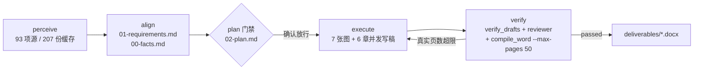

# 02 - M5 实战复盘：延锋地块施工组织设计端到端成稿

> 本文记录 M5 里程碑：以真实复杂招标资料 `6.10（山水）延锋地块`（248 个文件、10 层目录）为输入，驱动 `deepseek-flash` 走完五步认知闭环，产出可直接投标使用的原生 Word 技术标。

## 1. 输入与目标

| 项目 | 内容 |
|---|---|
| 资料规模 | 248 文件：171 PDF（629 页，含 158 张光栅化 A3 蓝图）、21 Excel、13 Word、37 DWG、`.HFZF` / `.18zhzb` 电子标 |
| 资料策略 | **只读挂载**，复用 M2 内容寻址缓存（207 份 ready，二次命中 1.59s） |
| 目标 | 《延锋地块东侧规划支路工程施工组织设计》6 章，含组织架构图、工艺流程图、横道图、工程量/机械表 |
| 硬约束 | 明标；A4、四号字、22 磅行距、页边距 上下 2.5 / 左 3.0 / 右 2.0 cm；**≤ 50 页** |

## 2. 五步执行轨迹

| 回合 | 主要动作 | 耗时 |
|---|---|---|
| Turn 1 | 感知、提取招标要求与补疑/变更、事实基线、章节规划、门禁确认、7 张 300dpi 配图 | 至轮次预算暂停 |
| Turn 2（`--resume`） | 6 子代理并发写稿（272s）→ 体检 → reviewer 挑刺（修正 4 项实质缺陷）→ 编译 → 两轮压缩 | 799s，轮次预算暂停 |
| Turn 3（`--resume`） | 重新体检、编译、收敛 | 25s |
| Turn 4（验收反馈） | 真实测页 51 页 → 定点精简第 3/5/6 章 → 49 页 → 微删 → **48 页** | 202s |

检查点断点续跑在 3 次跨进程恢复中均无状态丢失，验证了 M3 `SessionStateManager` 的设计。

## 3. 关键事实提取（全部可溯源）

- 项目编号 `2026BFJGZ50374`，招标人合肥经开区重点工程建设管理中心；0.6 km × 24 m 城市支路，预算 1771.818 万元。
- 工期 240 日历天（2026-06-18 开工）。
- **补疑 2 + 变更公告**：项目经理业绩改为市政公用工程、单合同 ≥ 1200 万元；开标改为 2026-06-10 11:00；报价系数 E1/E2 由 4/2 调为 3/1。
- 危大工程：雨水沟槽深基坑（挖深 ≤ 3.5 m）。
- 工程量逐项取自五专业清单 Excel（清表 58128.470 m³、AC-25C 8723.310 m²、管道 917.78 m、检查井 23 座、路灯 24 套等）。
- reviewer 纠正了一处事实错误：清单 38 项全为雨水系统，删除了初稿中虚构的“污水系统”。

## 4. 成品独立审计结果

由人工脚本独立解析成品（不采信智能体自述）：

| 指标 | 结果 |
|---|---|
| 一级章节 | 6 章，标题与 `02-plan.md` 一致 |
| 标题 / 表格 / 内嵌图片 | 64 / 15 / 7 |
| 中文字数 | 25,236 |
| 分节 | 3 节，横道图独立 A4 横版 1 节 |
| 页面与页边距 | 21.0 × 29.7 cm；2.5 / 2.5 / 3.0 / 2.0 cm ✅ |
| 占位符残留 | 0 |
| **真实页数（Word COM）** | **48 页 ≤ 50** ✅ |

成品：`test-temp/yanfeng-m5-live/deliverables/延锋地块东侧规划支路工程施工组织设计.docx`

## 5. 暴露的问题与架构修正

### 5.1 页数红线不能靠估算（本里程碑最重要的发现）

| 估算方式 | 结果 | 偏差 |
|---|---|---|
| 智能体自写几何公式 | 45.5 页 | 偏低 10%，**导致误报达标** |
| `audit_docx_file` 字符粗估 | 61 页 | 偏高 20% |
| Word 真实排版 | 51 页 | 基准 |

**修正**：`docx_auditor.measure_real_page_count()` 通过 PowerShell 驱动 Word COM（降级 LibreOffice → PDF 计页）测真实页数；`compile_word.py --max-pages N` 超限即判 `passed: false`；`SKILL.md` 明令禁止用自写公式宣布达标。修正后智能体仅凭一条反馈即自主完成“测页 → 定点精简 → 重编译”闭环。

> 设计原则再次印证：**硬约束必须由确定性工具判定，不能交给模型自评。**

### 5.2 其它修正

- `load_skill_detail` 结果在回合内被记忆折叠，导致后续找不到脚本路径 → 折叠时豁免该工具结果。
- 子代理迭代末期提醒收尾（`max_iters - 2`），共享简报上限提升到 10,000 字符，Orchestrator `max_iters` 提至 80。
- `audit_docx_file` 兼容字符串路径（智能体在 `run_python` 中常直接传字符串）。

## 6. 结论

M5 验证了“通用薄内核 + 领域技能 + 确定性工具门禁”架构可以在真实复杂资料上产出合规的交付物：事实可溯源、版式合规、页数受控，且长任务可跨进程断点续跑。
