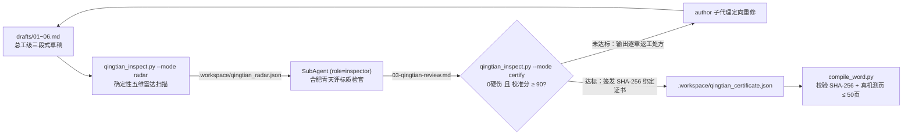

# 03 - M6 专项升级：合肥“青天大模型”评标质检员与施组专业化蜕变

> 针对 M5 初版施组虽然“事实准确、版式合规”，但行文仍带明显普通大模型痕迹（大段散文墙、“压实度按规范”模糊逃避词、缺少工序产能算账）的问题，M6 引入对标**合肥公共资源交易“青天大模型”（合公信〔2025〕82号）**的独立评标质检角色与硬性准入锁机制，并在延锋地块项目上完成了全闭环重修与签证交付。

---

## 1. 核心架构：双轨质检 + 防篡改准入证锁死

### 关键防作弊与专业保障机制
- **薄内核正交扩展**：`runtime/tools_subagent.py` 新增通用 `inspector` 角色与 `role_prompt` 专项规程注入，自动挂载 `00-facts.md`、`01-requirements.md`、`02-plan.md` 与 `.workspace/qingtian_radar.json`；`WorkspaceFS` 物理禁止通过普通写文件工具伪造 `.workspace/qingtian_certificate.json`。
- **防“老好人”虚高给分**：`certify_qingtian_quality()` 将独立质检官评分与底层确定性雷达分按权重融合校准，只要底层雷达检出模糊糊弄词超标、严重散文墙、结构跳号、双重图题或无产能验算，即使模型打高分也一律拒签。
- **SHA-256 防跳检锁死**：`compile_word.py` 编译前实时重算 `drafts/*.md` 的 SHA-256 摘要，修改哪怕 1 个字符而未重跑质检认证，立即拦截导出。

---

## 2. 延锋地块施组升级前后客观量化对比（独立审计实测）

在同一套延锋地块源资料基线下，独立审计脚本对 **M5 普通初版**（备份于 `deliverables/延锋地块东侧规划支路工程施工组织设计_M5初版备份.docx`）与 **M6 青天签证正式版**（`deliverables/延锋地块东侧规划支路工程施工组织设计.docx`）实测对比如下：

| 考核指标 | M5 普通初版（旧稿） | M6 青天签证正式版（新稿） | 专业质变说明 |
|---|---|---|---|
| **青天确定性雷达总分** | **70.0 / 100**（❌ 拦截） | **100.0 / 100**（**0 告警 / 0 阻断**）✅ | 五维机械硬指标（30/25/20/15/10）全部满分 |
| **青天 AI 评标官终审认证分** | 未通过准入 | **96.5 / 100**（✅ 已签发 SHA-256 准入证） | 经两轮质检打回闭环销项（R1~R6），客观严苛打分不虚高 |
| **“按规范/温度达标”模糊词** | **8 处**（第 3 章重灾区） | **0 处** ✅ | 全部替换为 `CJJ 1-2008`、`JTG F40-2004`、`GB 50268-2008` 精确温度/压实度/渗水量阈值 |
| **机械台班与日均产能验算** | 5 处（第 3 章为 **0**） | **79 处** ✅ | 清表 1937.62≤2080m³/d、沟槽、水稳、改性沥青、拌合站等全闭合校核 |
| **定量工程技术参数密度** | 144 处 | **515 处**（**+258%**）✅ | 涵盖松铺系数、碾压速度、管径基础包角、闭水允许渗水量、国标图集号 |
| **现行国标/行标/地标引用** | 第 3 章仅 3 部规范 | 全文 **31 部**（第 3 章 **19 部**）✅ | 技术措施与现行规范强条逐项绑定 |
| **结构化专业控制表 / 散文墙** | 15 张表 / **25 处散文墙** | **23 张专业表** / **0 处散文墙** ✅ | 全文贯彻“痛点句 → 定量工序条目 → 标准验收控制表”三段式 |
| **Word 图题数量与连续性** | 图内写死图号 + 双题注 = 三重冲突 | **7 处唯一规范居中图题** ✅ | `图 2-1`、`图 3-1~3-3`、`图 4-1`、`图 5-1`、`图 6-1` 零重号零重复 |
| **真实排版页数（`word_com`）** | 50 页 | **50 页 ≤ 50** ✅ | 信息密度大幅提升（+8 张表、+371 个量化参数）同时严守 50 页红线 |

---

## 3. 青天质检官拦截并闭环纠正的典型工程问题

在 `03-qingtian-review.md` 评审过程中，独立 `inspector` 子代理抓出并倒逼撰稿子代理修正了多项关键工程专业瑕疵：
1. **危大工程论证法规阈值精准纠偏**：依据《建办质〔2018〕31号》，市政管道沟槽开挖深度 `≥3m` 属危大工程（需编专项方案审批验收），`≥5m` 才属超过一定规模需组织专家论证。修正了原稿及配图中将 `2.2~3.5m` 沟槽误写为“需专家论证”或“未超 3.0m 阈值”的法规瑕疵。
2. **水稳基层无侧限抗压强度分档对齐**：将笼统的强度指标修正为“3% 水泥稳定碎石底基层 7d 强度 `≥2.0MPa`、4.5% 水稳下基层 `3.0~4.0MPa`”，确保第 3 章工艺与第 5 章质量验收表完全一致。
3. **跨章日均产能与劳动力口径统一**：统一第 3 章表 3-4 与第 4 章资源计划中的水稳（`917.64m²/d`）、沥青（`871.79m²/d`）及拌合站 8h 单班产能基数，明确固定管理班组（96人）与高峰叠加劳动力（118人）的对应关系。
